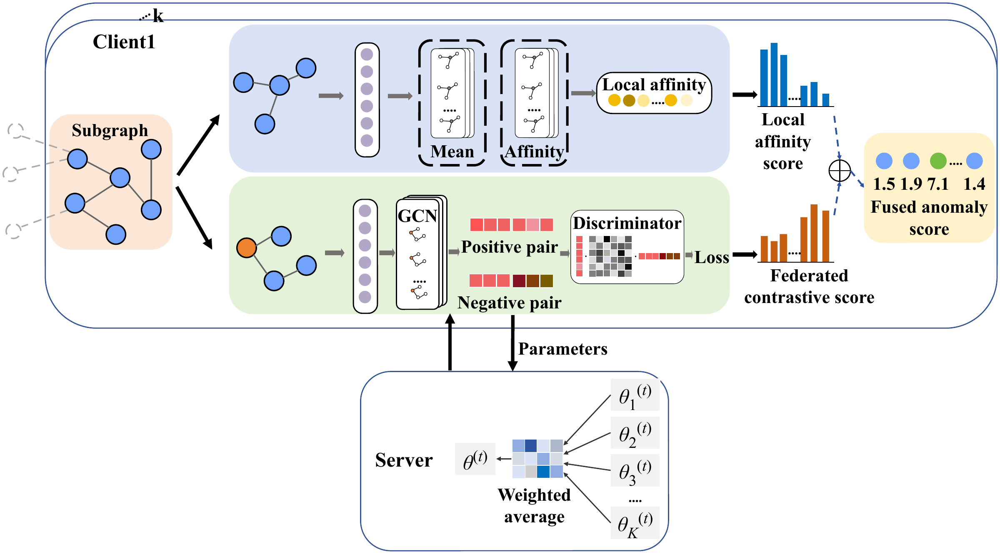

# LoFed: Fusing complementary local affinity and federated contrastive scores for federated graph anomaly detection



## Requirements

The code was verified with the following versions.

- Python 3.11.18
- PyTorch 2.7.1 (`2.7.1+cu128` for the CUDA runs)
- NumPy 1.26.4
- SciPy 1.13.1
- scikit-learn 1.5.2

## Datasets

`dataset/` contains ten `.npz` files. The prefixes `pubmed`, `acm`, `dblp`, `cs`, and `corafull` refer to PubMed, ACM, DBLP, Coauthor-CS, and Cora-Full, respectively. The suffix `_inj` denotes standard anomaly injection, and `_vgod` denotes the injection protocol recommended by VGOD.

| Array | Contents |
| --- | --- |
| `adj_data`, `adj_indices`, `adj_indptr`, `adj_shape` | Values, column indices, row pointers, and shape of the CSR adjacency matrix |
| `features` | Original node feature matrix, indexed by global node ID |
| `anomaly` | Binary node labels, with 1 for anomalies and 0 for normal nodes |
| `anomaly_type` | Node types, with 0 for normal, 1 for structural anomalies, and 2 for attribute anomalies |
| `eval_mask` | Boolean mask marking nodes included in evaluation |

`partitions/` contains the METIS partitions used in the paper. Files are named `{dataset}_metis_rho00_K{K}_seed0.npz` and contain `client_0` through `client_{K-1}`, which list global node IDs in each client. The `_vgod` partitions support K = 5, 10, 15, 20, and 25. The `_inj` partitions support K = 5, 10, and 15. The CLI seed controls training and scoring. Partition files use the fixed partition seed 0.

## Running the experiments

Run these commands from the repository directory.

```sh
python -B run.py --dataset pubmed_vgod --clients 5 --seed 0 --device cuda --out ../results/pubmed_vgod_K5_seed0 --save-model
python -B run.py --dataset dblp_inj --clients 10 --seed 0 --device cpu --out ../results/dblp_inj_K10_seed0
python -B run.py --help
```

`--dataset` selects a dataset file, `--clients` selects the corresponding partition, and `--seed` sets the random seed. The defaults are 5 clients and seed 0. `--rounds`, `--epochs`, `--lr`, `--samples`, and `--hidden` default to 15 federated rounds, 15 local epochs per round, a learning rate of 0.001, 256 scoring samples, and 64 embedding dimensions. `--device` defaults to `cuda` and also accepts `cpu`. Set `--out` to choose the output directory. Its default is `results/{dataset}_K{K}_seed{seed}` relative to `run.py`.

- `scores.npz` stores `global_node`, `client`, `s_local` (float64), `s_fed` (float32), and `s_fused` (float64) in client order.
- `metrics.json` stores `W_AUROC` and `W_AP`. Both metrics weight each client's score by its number of evaluation nodes and skip clients with a single evaluation label.
- `--save-model` also writes the final global model's state dictionary to `model.pt`.
